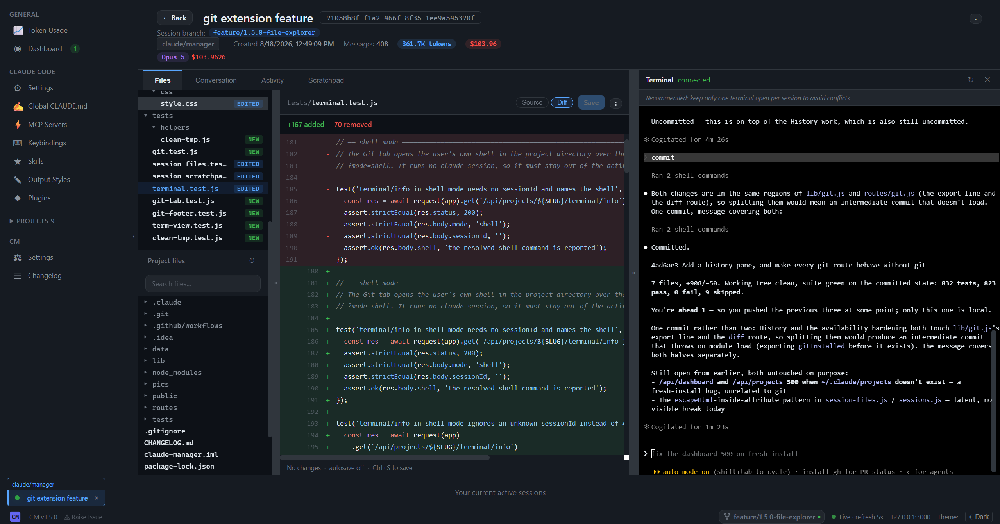

# CM

A local web UI for managing Claude Code configuration — settings, memory, MCP servers, keybindings, skills, output styles, sessions, token usage, and more.

> Not affiliated with or endorsed by Anthropic.

Runs entirely on your machine. No cloud, no accounts, no external dependencies beyond Node.js.



## Quick Start

**macOS / Linux / Git Bash on Windows:**
```bash
./run.sh
```

**Windows (Command Prompt / PowerShell):**
```cmd
run.bat
```

The script will install Node.js if missing, install dependencies, and open the app in your browser automatically.

Run the script without an argument to pick an option from a menu (↑/↓ and Enter, or press its number), or pass the option directly:

| Option | Action |
|--------|--------|
| `1` | Start — install deps, start server, open browser |
| `2` | Stop — kill the running server |
| `3` | Update (git) — `git pull` + reinstall deps |
| `4` | Update (zip) — download latest release zip from GitHub |

## Requirements

- **Claude Code CLI** installed in the terminal (`claude` on PATH, `~/.claude/` exists) — Claude Desktop alone is not enough; CM reads `~/.claude/` and starts `claude` for terminals and Task Board tickets
- Node.js 18+ (the run script checks your version and links to nodejs.org if it's missing or too old)
- git (optional) — the Git panel appears only for projects that are repositories, on machines that have git; everything else works without it

## What It Manages

| Feature | Config File | Actions |
|---------|-------------|---------|
| **Dashboard** | — | Recent sessions, usage summary, quick links |
| **Task Board** | `data/` | Tickets per project run through a workflow by background Claude sessions |
| **Token Usage** | `data/usage-index.json` | Stats, cost estimates, breakdowns, charts |
| **Settings** | `~/.claude/settings.json` | Tree editor, raw JSON, reference panel |
| **CLAUDE.md** | `~/.claude/CLAUDE.md` | Markdown editor with live preview |
| **MCP Servers (user scope)** | `~/.claude.json` → `mcpServers` | Add, edit, enable/disable, delete |
| **Cloud Integrations** | `~/.claude/.credentials.json` (read-only) | View OAuth-connected services |
| **Keybindings** | `~/.claude/keybindings.json` | Map key combos to actions |
| **Skills** | `~/.claude/skills/*/SKILL.md` | Create, edit, delete |
| **Output Styles** | `~/.claude/output-styles/*.md` | Create, edit, delete |
| **Plugins** | `~/.claude/plugins/` | View marketplaces and blocklist |
| **Project Memory** | `~/.claude/projects/*/memory/` | Edit memory files, export/import as ZIP |
| **Sessions** | `~/.claude/projects/*/` | Browse, rename, search, replay, in-page terminal |
| **Project Files** | `<project>/**` | Browse, view and edit files |
| **Git** | `<project>/.git` | Commit, push, pull, diffs, history, shell |
| **Project Settings** | `.claude/settings.local.json`, `.claude/settings.json` | Edit project permissions |
| **Project MCP (project scope)** | `<project>/.mcp.json` | Project MCP servers (in git) |
| **Project MCP (local scope)** | `~/.claude.json` → `projects["<path>"].mcpServers` | Per-project, per-user MCP servers |
| **Project Agents** | `.claude/agents/*.md` | Create, edit, delete subagents |
| **Project Skills** | `.claude/skills/*/SKILL.md` | Project skills |
| **Project Output Styles** | `.claude/output-styles/*.md` | Project output styles |
| **Manager Settings** | `data/` | Pricing source, history, manual pricing, editor and Task Board options |

### MCP scopes

CM shows each MCP scope where Claude Code stores it, matching `claude mcp list`:

- **User** → `~/.claude.json` → `mcpServers` (global **MCP Servers** page)
- **Project** → `<project>/.mcp.json` (project **MCP** tab)
- **Local** (default) → `~/.claude.json` → `projects["<path>"].mcpServers` (project **MCP** tab)

## Highlighted Features

### Task Board
All projects on one board, one lane per project, showing the project's current git branch.

- **Workflows** — stages between Ready and Done built from the project's skills and agents; draw them as a diagram with conditions and loop limits; save, load, export and import workflows.
- **Tickets run by themselves** — Ready starts a background Claude session that works through the stages; it waits when it needs your input. A type icon (bug, feature, question, other) shows on each card.
- **Parallel lanes** — several tickets at once (3 by default, set in CM Settings); in a git project each gets its own worktree and branch.
- **Finalize** — runs the project's tests; a worktree ticket then waits for you to Merge (no squash) or Create PR.
- **Follow-ups and notes** — drag a ticket back to ToDo to follow up; keep private notes and to-dos on finished tickets.

### Token Usage
Token and cost tracking across all sessions with charts, usage marks and AI efficiency insights. Pricing is fetched from Anthropic and kept in a history log.

### Sessions
Full conversation replay with tailored tool-use views, full-text search across a project, and an embedded terminal in the project directory.

### Files
A session's **Files** tab pins the files it changed above the project tree; open any file to view, diff or edit it (CodeMirror, optional autosave). The **Scratchpad** tab shows Claude's temp files.

### Git
A Git panel per project: commit, push, fetch and pull (`--ff-only`), diffs, paged history, a project shell and ~50 git recipes that are typed into the shell but never run for you.

### Sidebar & Themes
Star favorite projects to pin them on top; a Compact switch shows only General and Projects. Four themes: Dark, Light, Matrix and Default (Catppuccin).

## Architecture

```
server.js          # Express entry point
lib/               # Shared server helpers
  paths.js         # Path constants
  file-helpers.js  # File I/O: backup, readJson, validation
  slug.js          # Project slug <-> filesystem path decoder
  frontmatter.js   # YAML frontmatter read/write helpers
  usage-index.js   # Token usage indexer and aggregation
  git.js           # Non-interactive git invocation + status, log and commit helpers
  diff.js          # Line diff shared by file history and the git panel
  terminal-server.js # WebSocket <-> pty bridge for claude sessions and project shells
  task-board*.js   # Task Board store, workflow and ticket runner
routes/            # Express route modules
data/              # App-local storage (gitignored, never in ~/.claude/)
public/
  index.html       # SPA shell
  css/style.css    # Dark/light theme
  js/
    utils.js       # Shared client utilities + constants
    code-view.js   # Shared split layout, code viewer, rendered preview
    term-view.js   # Shared xterm.js + WebSocket terminal lifecycle
    git-panel.js   # Git: changes, diff, history, shell, recipes
    modal.js       # Modal dialog factory
    app.js         # Navigation and routing
    [feature].js   # One file per UI feature
```

**Stack**: Express + vanilla JS. npm dependencies: `express`, `gray-matter`, `node-pty`, `ws`, `adm-zip`. No build step, no TypeScript, no framework.

## Cross-Platform

Works on Windows, macOS, and Linux. Path resolution handles all OS conventions automatically.

## Security

- Server binds to `127.0.0.1` only — never exposed to the network
- All config file writes create a backup first (project files saved from the Files tab are written directly, last write wins)
- Path traversal is prevented on all endpoints
- No credentials or secrets are ever written — only read for display
- Git runs with prompts disabled and a timeout, so a call can never hang the UI waiting for credentials
- Only safe git operations are exposed as actions (`pull --ff-only`, `fetch --prune`, no forced push); rewriting history is left to the shell, where git can ask you
- A commit is only ever addressed by a validated hex sha, never by raw input
- API requests are rate-limited (10000/min by default, board hooks exempt, `CM_RATE_LIMIT` to change)

### CodeQL

CodeQL runs on every PR, push to `main` and weekly (JavaScript and GitHub Actions workflows). To run it locally:

1. Download the [CodeQL bundle](https://github.com/github/codeql-action/releases/latest) for your OS and extract it into `.codeql/` (giving `.codeql/codeql/codeql`), or put `codeql` on `PATH`, or set `CODEQL_PATH`
2. `npm run codeql` — exits non-zero on findings
3. Optional, scan before every push: `git config core.hooksPath .githooks`

## Changelog

See [CHANGELOG.md](CHANGELOG.md) for release notes.

## Screenshots

### Session Detail


### Dashboard


### Token Usage

